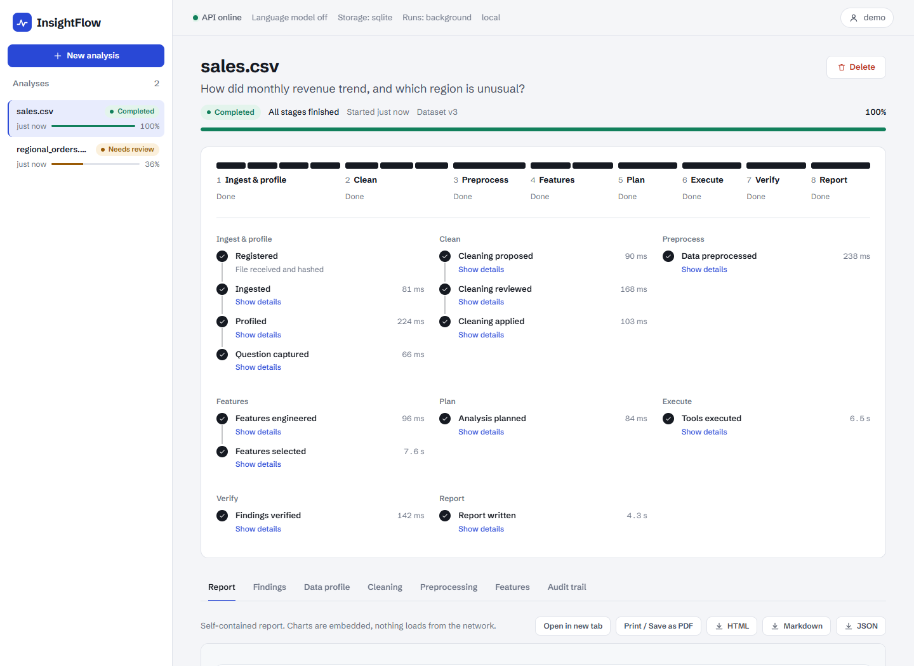
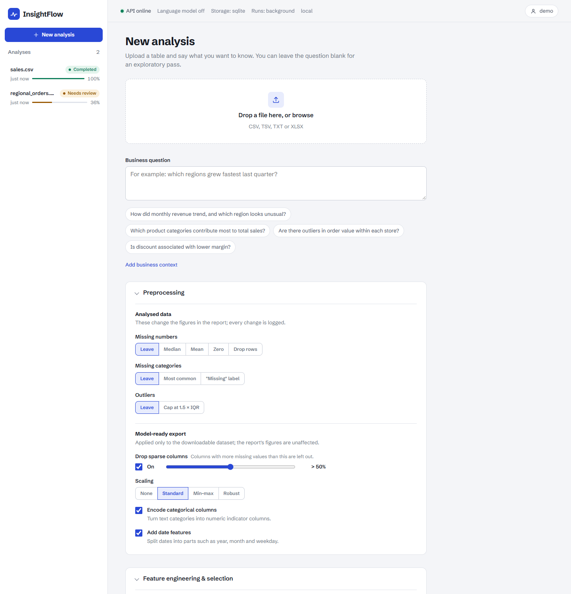
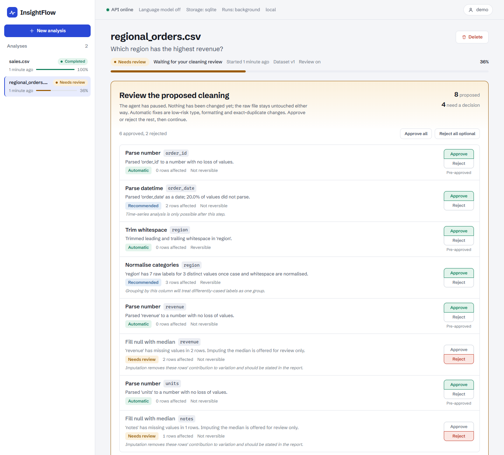
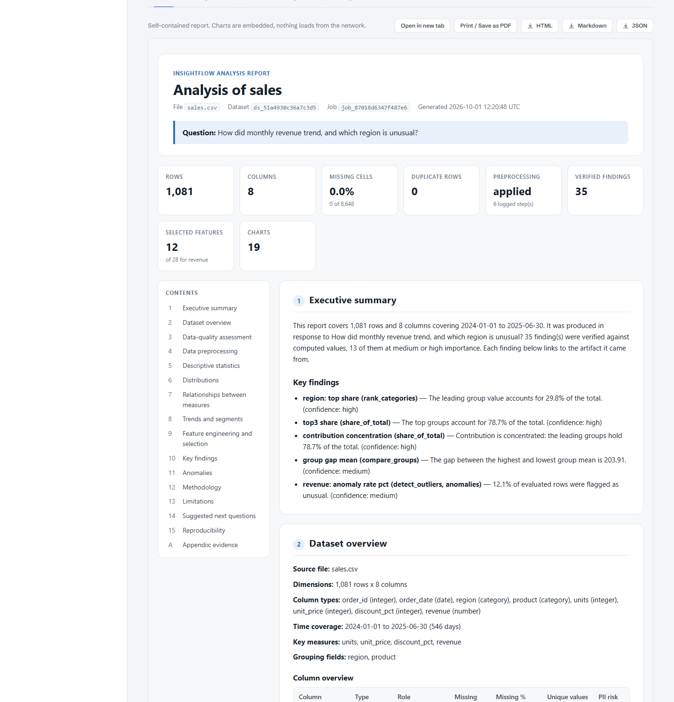
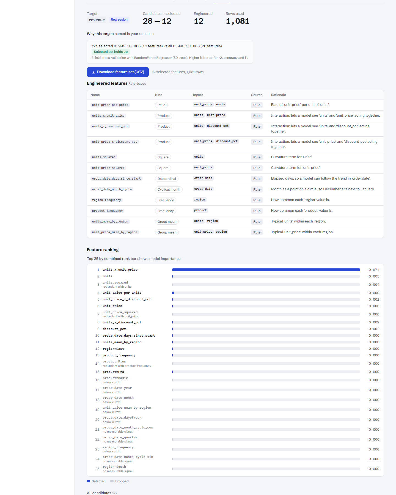
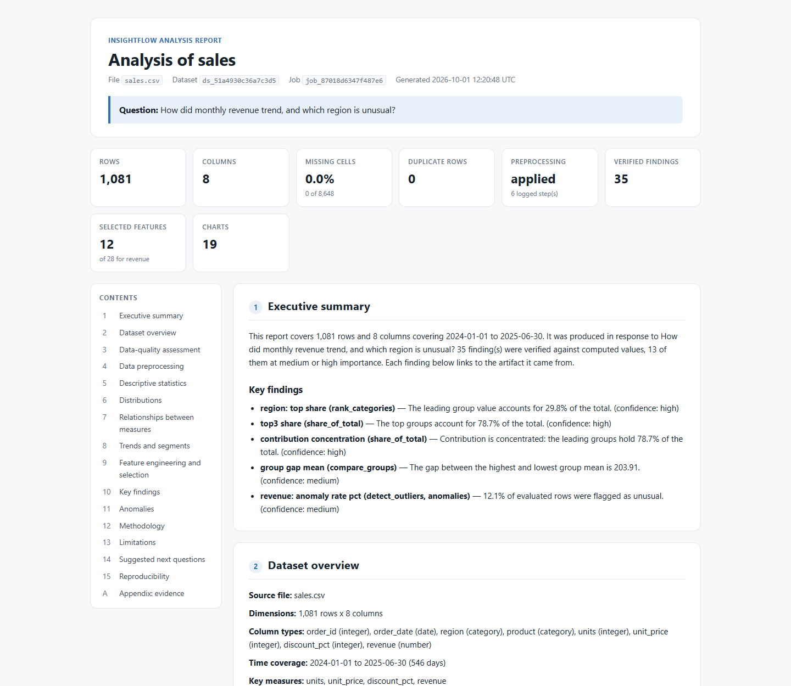
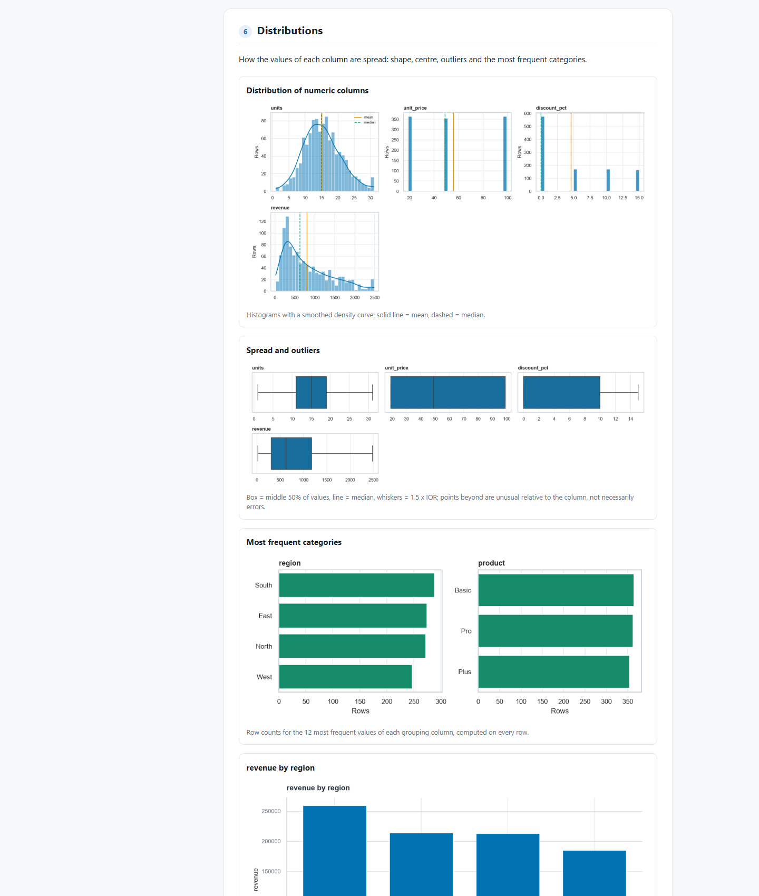
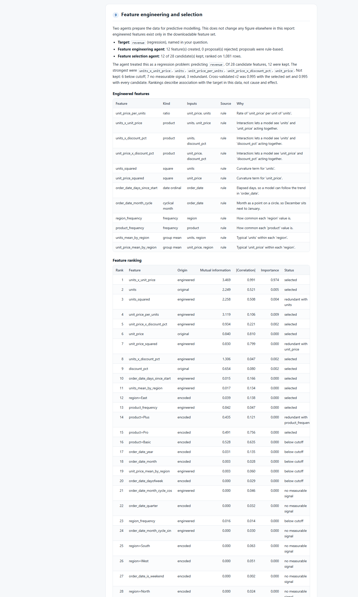
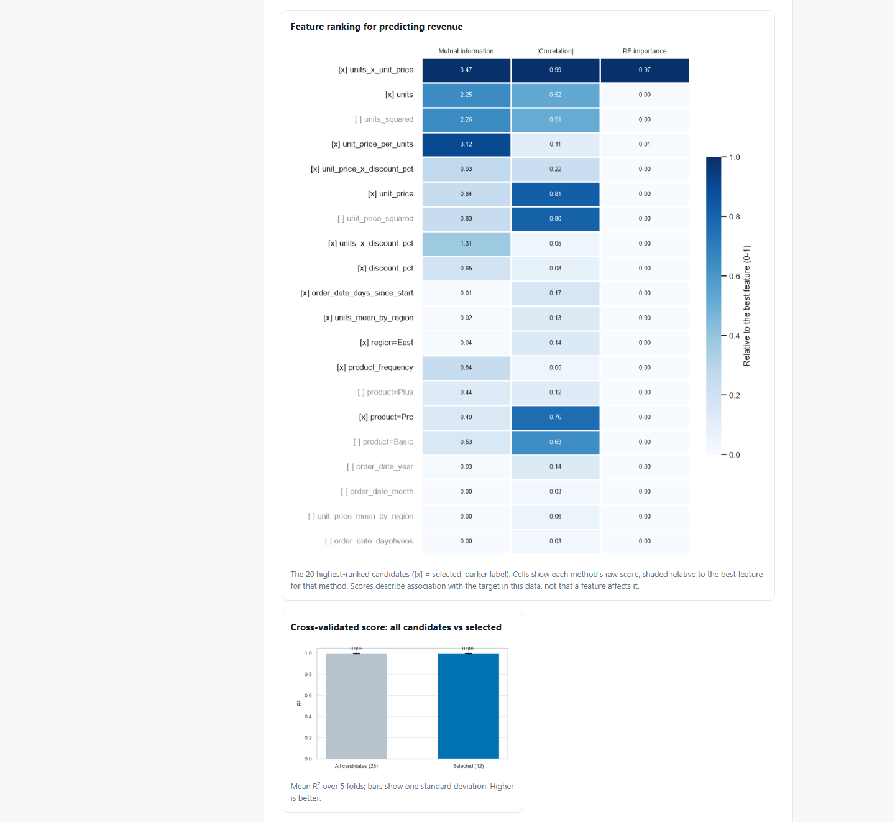
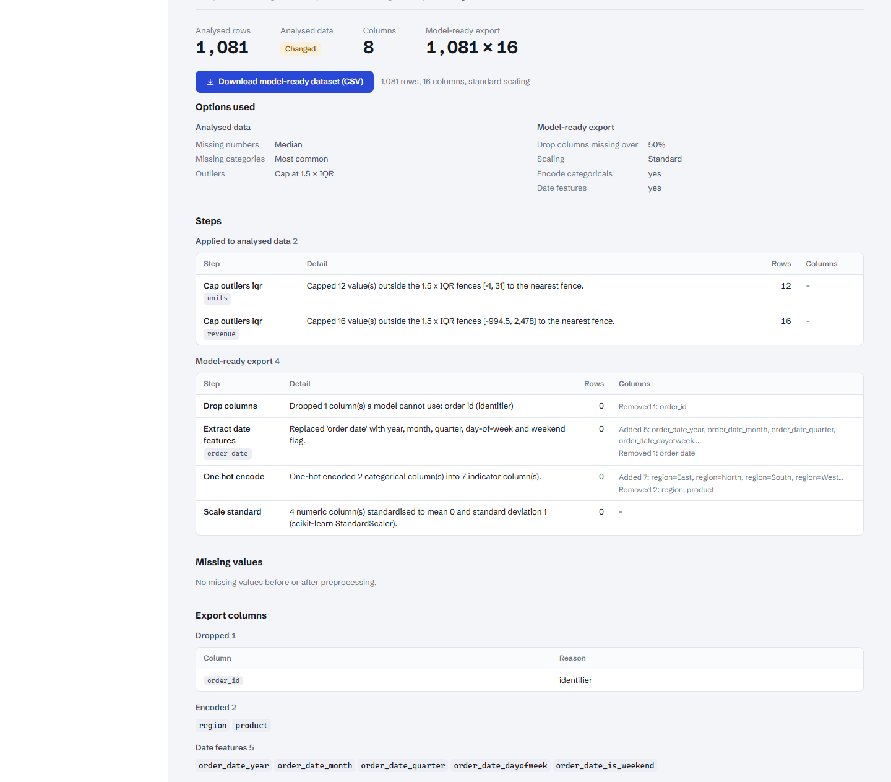

# InsightFlow

A secure agentic data-analysis platform. Upload a CSV or XLSX file, ask a business
question, and get a verified, fully organised report with evidence, statistics
tables, charts, limitations and an audit trail. Along the way the agents clean
and preprocess the data, engineer and select features for modelling, and hand
you a model-ready dataset.



**At a glance**

- A 14-stage agent lifecycle: ingest → profile → clean (with an optional human
  review gate) → preprocess → **feature engineering** → **feature selection** →
  plan → execute → verify → report. It is resumable, cancellable and audited.
- Seven agents: planner, cleaning explainer, **feature engineer**, **feature
  selector**, finding factory, verifier and composer. An optional LLM may propose
  or phrase things; code validates every proposal, and no model ever writes a
  number.
- A structured report built with pandas, NumPy, seaborn and matplotlib:
  summary cards, contents, 15 numbered sections, every table citing its CSV.
- A React web UI, a REST API and a queue worker. Job state lives in SQLite or
  Supabase Postgres, and the whole stack ships as Docker images.

Two properties drive every design decision here:

- **Every number is computed, not written.** Numerical analysis is deterministic
  Python. A language model may plan the analysis and write the prose, but it never
  produces a figure that appears in a report.
- **Every figure is checkable.** Each metric a finding cites is written into a
  machine-readable evidence table, and the report links finding → metric →
  artifact. A test enforces that every published number can be re-derived from
  the table it is cited from.

## Screenshots

| | |
| --- | --- |
|  **New analysis:** upload, question, preprocessing and feature-agent options |  **Review gate:** the agent pauses until you approve or reject each proposed fix |
|  **Report tab:** self-contained report, downloadable as HTML, Markdown or JSON |  **Features tab:** target, engineered features, ranking, cross-validation, feature-set download |
|  **Report:** summary cards, contents and numbered sections |  **Distributions:** seaborn histograms with density curves, box plots |
|  **Feature engineering and selection** section of the report |  **Ranking heatmap** (three methods) and **cross-validated score** |
|  **Preprocessing tab:** what changed, model-ready export download | |

Screenshots are reproducible: `node infra/scripts/screenshots.mjs <base-url>
<owner-id> <completed-job> <review-job> docs/screenshots [report.html]` drives
headless Chrome against a running instance.

## Running the project

The quickest path, once the prerequisites are installed:

```bash
uv sync                                      # backend dependencies
uv run python -m insightflow_api             # terminal 1: API on :8000
cd apps/web && npm install && npm run dev    # terminal 2: UI on :5173
```

Then open <http://localhost:5173>. The rest of this section covers each step,
the other ways to run it, and what to do when something goes wrong.

### 1. Prerequisites

| Tool | Version | Check | Install |
| --- | --- | --- | --- |
| Python | 3.11 or newer | `python --version` | <https://www.python.org/downloads/> (uv can also fetch it for you) |
| uv | any recent | `uv --version` | see below |
| Node.js | 18 or newer (for the web UI) | `node --version` | <https://nodejs.org/> (LTS) |

Install uv:

```bash
# macOS / Linux
curl -LsSf https://astral.sh/uv/install.sh | sh
```

```powershell
# Windows (PowerShell)
powershell -ExecutionPolicy ByPass -c "irm https://astral.sh/uv/install.ps1 | iex"
```

Docker is only needed for the optional container setup (step 8). No database
server is needed: job state goes to a local SQLite file by default.

### 2. Install the backend

From the repository root:

```bash
uv sync
```

This creates `.venv/` and installs every workspace package (`packages/*`,
`apps/api`, `apps/worker`) plus the dev tools. Run it again after pulling changes.

Optional check that everything works (about 4 minutes, 300+ tests):

```bash
uv run pytest
```

### 3. Start the API

```bash
uv run python -m insightflow_api
```

You should see Uvicorn report `Uvicorn running on http://127.0.0.1:8000`.
Confirm it in a browser or another terminal:

```bash
curl http://127.0.0.1:8000/health
```

```json
{"status":"ok","llm_enabled":false,"execution_mode":"background","state_backend":"sqlite", ...}
```

`execution_mode: background` means uploads return immediately and the analysis
runs on a background thread, which is what the web UI expects. Leave this
terminal running.

> Use `python -m insightflow_api` rather than `uvicorn insightflow_api.service:app`.
> Plain Uvicorn runs jobs *inside* the upload request, so the UI cannot show the
> stages while they run.

To change the port or host, set `INSIGHTFLOW_PORT` / `INSIGHTFLOW_HOST` first
(see step 7 for how to set variables). Interactive API docs are at
<http://127.0.0.1:8000/docs>.

### 4. Start the web UI

In a second terminal:

```bash
cd apps/web
npm install        # first time only
npm run dev
```

Open <http://localhost:5173>. The dev server forwards `/api` and `/health` to
the API on port 8000, so start the API first.

### 5. Run your first analysis

A ready-made dataset is included: `examples/sales.csv` (about 1,000 orders over
18 months, with date, region, product, units, price, discount and revenue).

1. Click **New analysis** and drop in `examples/sales.csv`.
2. Ask a question, for example *"How did monthly revenue trend, and which region
   is unusual?"*. Leave it blank for a general exploratory analysis.
3. Optionally tick **Review cleaning before it's applied**. The agent will then
   stop after proposing data fixes and wait for you to approve or reject each one.
4. Optionally open **Preprocessing** (imputation, outlier capping, export
   settings) and **Feature engineering & selection** (target column, how many
   features to keep). The defaults are sensible; leave the target blank and the
   agent picks it from your question.
5. Submit. The job page shows each lifecycle stage as it runs: ingest & profile,
   clean, preprocess, features, plan, execute, verify, report.
6. When it finishes, use the tabs for the **Report** (downloadable as HTML,
   Markdown or JSON), **Findings** with their evidence, the **Data profile**,
   the **Cleaning** change log, **Preprocessing** (with the model-ready dataset
   download), **Features** (with the feature-set download) and the **Audit trail**.

Your workspace is identified by an id kept in the browser (top-right popover).
Jobs from another workspace id are not visible, so copy it if you want to come
back to the same jobs from another browser.

### 6. Other ways to run it

**Single process (API serves the UI).** Build the UI once; the API then serves
it at <http://127.0.0.1:8000/>, so you only need one terminal:

```bash
cd apps/web && npm install && npm run build && cd ../..
uv run python -m insightflow_api
```

Rebuild after changing frontend code, and restart the API after the first build
(it checks for `apps/web/dist` at startup).

**API plus a separate worker.** Closer to production: the API only queues jobs
and a worker process claims and runs them. Several workers can run at once.

```bash
# bash
INSIGHTFLOW_EXECUTION_MODE=worker uv run python -m insightflow_api   # terminal 1
uv run python -m insightflow_worker                                  # terminal 2
```

```powershell
# PowerShell
$env:INSIGHTFLOW_EXECUTION_MODE = "worker"; uv run python -m insightflow_api   # terminal 1
uv run python -m insightflow_worker                                           # terminal 2
```

**API only, no UI.** Every request names its workspace with `X-Owner-Id`:

```bash
curl -H "X-Owner-Id: me" -F "file=@examples/sales.csv" \
  -F "question=How did monthly revenue trend, and which region is unusual?" \
  http://127.0.0.1:8000/api/v1/jobs
# -> {"job_id": "job_...", "status": "running", ...}

curl -H "X-Owner-Id: me" http://127.0.0.1:8000/api/v1/jobs/<job_id>          # progress
curl -H "X-Owner-Id: me" "http://127.0.0.1:8000/api/v1/jobs/<job_id>/report?embed=true" -o report.html
```

On Windows PowerShell, call `curl.exe` (not `curl`, which is an alias for
`Invoke-WebRequest`) with the same arguments.

### 7. Configuration

Settings are read from environment variables (no `.env` file is loaded on its
own). `.env.example` lists them all. Set them in the terminal before starting
the API or worker:

```bash
# bash / zsh
export INSIGHTFLOW_PORT=8080
```

```powershell
# PowerShell (current window only)
$env:INSIGHTFLOW_PORT = "8080"
```

Or copy `.env.example` to `.env`, edit it, and pass it explicitly:
`uv run --env-file .env python -m insightflow_api`.

Common changes:

- **Use Supabase for job state:** set `INSIGHTFLOW_STATE_DATABASE_URL` to your
  Supabase Postgres connection string. See [Using Supabase for job
  state](#using-supabase-for-job-state).
- **Turn on the language model** (planning and prose only; numbers are always
  computed): set `INSIGHTFLOW_LLM_ENABLED=true` and `INSIGHTFLOW_LLM_API_KEY`.
  `INSIGHTFLOW_LLM_BASE_URL` points at any OpenAI-compatible endpoint. With it
  off, a deterministic planner is used and everything still works.
- **Store data somewhere else:** `INSIGHTFLOW_ARTIFACT_ROOT` (default `artifacts/`).

The full list is in [Configuration](#configuration) below.

### 8. Docker (optional)

```bash
cp .env.example .env     # optional: Supabase URL, LLM key
docker compose -f infra/docker/docker-compose.yml --env-file .env up -d --build
```

This builds one image (the web UI is compiled in a Node stage and served by the
API) and starts the API on port 8000 plus a worker, sharing an artifacts volume.
Open <http://127.0.0.1:8000/>. For servers, TLS and authentication see
[Deployment](#deployment).

### 9. Where data lives, and starting over

| What | Where |
| --- | --- |
| Uploaded originals, cleaned data, charts, tables, reports | `artifacts/` (or `INSIGHTFLOW_ARTIFACT_ROOT`) |
| Jobs, stage history, audit log | `artifacts/insightflow.db` (or your Supabase database) |

To reset everything locally, stop the API and delete the `artifacts/` folder.
To remove a single job, use **Delete** on its page or `DELETE /api/v1/jobs/{id}`.
Artifacts are kept for `INSIGHTFLOW_RETENTION_DAYS` (default 7).

### 10. Troubleshooting

| Symptom | Cause and fix |
| --- | --- |
| `Failed to spawn: insightflow-api` / *An Application Control policy has blocked this file* (Windows) | Your machine blocks the `.exe` launchers uv generates. Use `uv run python -m insightflow_api` and `uv run python -m insightflow_worker`, which run the same code without them. |
| The UI loads but jobs and health fail to load | The API is not running on port 8000, or was started on another port. Start it (step 3). The Vite proxy always targets `127.0.0.1:8000`; change it in `apps/web/vite.config.ts` if you need another port. |
| Uploading takes a long time and the job page appears already finished | The API is in `inline` mode (you probably started it with plain `uvicorn`). Start it with `uv run python -m insightflow_api`, or set `INSIGHTFLOW_EXECUTION_MODE=background`. |
| `401` from the API | Every request needs an `X-Owner-Id` header. The UI adds it; add it yourself for `curl`. |
| `415` when uploading | The file type is not supported (`.csv`, `.tsv`, `.txt`, `.xlsx`), or the sheet name you chose is not in the workbook. The response lists the available sheets. |
| A job sits at *Awaiting review* | You ticked "Review cleaning before it's applied". Approve or reject the proposed operations and click **Apply & continue**. |
| Jobs stay *pending* forever | The API is in `worker` mode and no worker is running. Start `uv run python -m insightflow_worker`. |
| `[Errno 10048]` / `address already in use` | Port 8000 is taken. Stop the other process, or set `INSIGHTFLOW_PORT` and update the Vite proxy to match. |
| `uv sync` complains about a workspace member | Run it from the repository root, not from `apps/web` or a package folder. |
| Supabase connection errors | Check the password in the connection string, and that you copied the **URI** form. The transaction pooler (port 6543) and the direct connection (port 5432) both work. |

## Agent lifecycle

```text
registered → ingested → profiled → intent_captured → cleaning_proposed → cleaning_reviewed ⏸
           → cleaning_applied → preprocessed → features_engineered → features_selected
           → planned → executed → verified → reported
```

- **Human review gate.** With `require_review`, the job stops at
  `cleaning_reviewed` with status `awaiting_review`. `POST
  /jobs/{id}/cleaning/decision` records which operations to accept or reject on
  the job itself, then resumes. Accepted operations are applied; rejected ones,
  including rejected automatic ones, are not.
- **Resumable across processes.** A job resumed by a different API process or
  worker rebuilds its dataset, profile, cleaning and plan from the stored
  original and the persisted stage outputs. Execution and verification are
  recomputed rather than trusted from memory.
- **Cancellation** is checked between stages and is never overwritten by a
  stage that was mid-flight when it arrived.
- **Execution modes** (`INSIGHTFLOW_EXECUTION_MODE`): `inline` (inside the
  request; tests), `background` (thread in the API process; default for
  `python -m insightflow_api`), `worker` (queued for `python -m insightflow_worker`, which claims
  jobs with an atomic conditional update).

## What it does

1. **Ingest** — detect encoding and delimiter, normalise headers, hash the raw
   bytes, reject oversized or unsafe files.
2. **Profile** — infer column types and semantic roles, detect PII and quality
   issues, and record what the data *cannot* support.
3. **Clean** — propose transforms split into automatic and review levels. Only
   automatic transforms apply without approval, and every change is logged with
   a before/after and an inverse note. Cleaned data gets a new version; the raw
   file is never modified.
4. **Preprocess** — prepare the data for analysis and for modelling (see
   [Preprocessing](#preprocessing)). Optional changes to the analysed data are
   logged with exact counts; a model-ready dataset is always produced as a download.
5. **Engineer features** — an agent picks the prediction target and proposes
   new features; code validates each one (no target leakage, no personal data).
6. **Select features** — an agent ranks candidates by mutual information,
   correlation and random-forest importance, prunes redundant ones and
   cross-validates the result. See [Feature engineering and selection](#feature-engineering-and-selection).
7. **Plan** — map the question onto registered tools. Steps the dataset cannot
   support are dropped and named, rather than executed and faked.
8. **Execute** — run tools with strict parameter and column-type validation.
   Failed steps are recorded, not hidden.
9. **Verify** — check every finding for evidence, artifact existence, dataset
   version, internal contradictions and prohibited language.
10. **Report** — run the exploratory analysis and render a structured,
    self-contained HTML report (see [The report](#the-report)), with Markdown and
    JSON exports.

## Preprocessing

Cleaning repairs the file; preprocessing prepares it. It has two scopes that are
kept strictly apart, chosen per upload in the **Preprocessing** panel of the
New analysis form (or the `preprocessing` JSON form field of `POST /api/v1/jobs`):

| Scope | Option | Values (default first) | Effect |
| --- | --- | --- | --- |
| Analysed data | `missing_numeric` | `none`, `median`, `mean`, `zero`, `drop_rows` | Fill or drop missing numbers in measure columns |
| Analysed data | `missing_categorical` | `none`, `mode`, `constant` | Fill missing categories (most common value, or `Unknown`) |
| Analysed data | `outliers` | `none`, `cap_iqr` | Cap values outside the 1.5 x IQR fences |
| Model-ready export | `drop_columns_missing_above` | `0.5`, any 0-1, or `null` | Drop columns with more missing values than this |
| Model-ready export | `scaling` | `standard`, `minmax`, `robust`, `none` | scikit-learn scaler for numeric columns |
| Model-ready export | `encode_categoricals` | `true`, `false` | One-hot encode categories (up to 20 levels) |
| Model-ready export | `date_features` | `true`, `false` | Replace dates with year, month, quarter, weekday, weekend flag |

- **Analysed-data options change the figures in the report**, so they are off by
  default. Identifiers, time axes, free text and personal-data columns are never
  imputed or capped. Each change is logged with the number of values or rows it
  touched, and the dataset version advances.
- **The model-ready export** is built with pandas, NumPy and scikit-learn. It
  drops identifiers, personal data, constant and mostly-empty columns, imputes
  what remains, encodes and scales. It is a CSV download (Preprocessing tab, or
  `GET /api/v1/jobs/{id}/artifacts/model_ready_dataset`) and does not feed any
  figure in the report, because scaled or encoded values are not business numbers.
- `GET /api/v1/jobs/{id}/preprocessing` returns the full record: options, every
  step, missing values before and after, and the export's shape and dropped columns.

## The report

Every report has the same structure: a header with the question, a strip of
headline numbers (rows, columns, missing cells, duplicates, preprocessing,
verified findings, charts), a table of contents, and numbered sections:

1. Executive summary · 2. Dataset overview (column overview table) ·
3. Data quality (missing-values table and chart) · 4. Data preprocessing ·
5. Descriptive statistics (numeric and categorical tables) · 6. Distributions
(histograms with density curves, box plots, category frequencies) ·
7. Relationships (annotated correlation heatmap, strongest pairs, scatter with fit) ·
8. Trends and segments (time trend with rolling mean, segment totals and spread) ·
9. Feature engineering and selection (engineered features, rejected proposals,
ranking heatmap, ranking table, cross-validation) · 10. Key findings ·
11. Anomalies · 12. Methodology · 13. Limitations · 14. Suggested next questions ·
15. Reproducibility · Appendix: evidence tables.

Exploratory views are computed with pandas and NumPy and drawn with seaborn and
matplotlib (`packages/visualization/.../eda.py`); the analysis tools' own charts
use the same theme and are placed in the section they belong to. The usual
guarantees hold: every table cites the CSV holding its unrounded values, charts
are deterministic (charts over 20,000 rows use a fixed-seed sample, stated in the
caption), and personal-data columns are never tabulated or charted by value.
The HTML is self-contained (no external fonts or scripts), responsive, and prints
cleanly to PDF.

## Feature engineering and selection

Two agents prepare the data for predictive modelling, between preprocessing and
analysis planning. They work on a copy, so **no reported figure changes**; their
output is a downloadable feature set and a report section. Full details are in
[docs/agents.md](docs/agents.md).

**Feature engineering agent**

1. **Picks the target:** the column you named, else one your question
   mentions, else the headline measure (revenue, sales, GDP…). Then it decides
   between regression and classification.
2. **Proposes features:** log transforms of skewed measures, ratios,
   interactions, squares, elapsed days, cyclical month (sin/cos), frequency
   encodings, group means and missing-value flags. With an LLM enabled and
   consented, the model's proposals come first.
3. **Validates every proposal in code.** It refuses anything that uses the
   target (leakage), personal data, identifiers or nonexistent columns, or has
   the wrong input types. Each refusal and its reason is listed in the report.

**Feature selection agent**

1. **Filters** near-constant columns.
2. **Ranks** every candidate by mutual information, absolute correlation and
   random-forest importance, then combines the three ranks.
3. **Prunes** features that are redundant (|r| > 0.95 with a stronger one) or
   show no signal, and keeps the best `max_features`.
4. **Cross-validates** (5-fold, seeded) all candidates against the selected set,
   so you can see whether selection cost accuracy.

On the sample data it finds `units × unit_price` (gross value) as the strongest
predictor of revenue and keeps 12 of 28 candidates with the same cross-validated
R² as using all 28.

| Option (`features` JSON field / UI panel) | Default |
| --- | --- |
| `enabled` | `true` |
| `target_column` | `null` (the agent chooses) |
| `max_features` | `15` |
| `max_engineered` | `20` |

`GET /api/v1/jobs/{id}/features` returns both agents' records; the feature set
is `GET /api/v1/jobs/{id}/artifacts/feature_set`.

## Analysis tools

19 registered tools, each with a declared parameter schema, column-type
requirements, timeout and determinism flag.

| Type | Tool | What it answers |
| --- | --- | --- |
| descriptive | `describe_measures` | Count, sum, mean, median, spread, shape per numeric column |
| descriptive | `missingness_profile` | Missing and distinct counts per column |
| descriptive | `rank_categories` | Rank a category by row count or measure, with share of total |
| descriptive | `value_distribution` | Histogram bins plus skewness |
| comparison | `compare_groups` | Measure across groups, with Welch/Mann-Whitney test and effect size |
| comparison | `share_of_total` | Contribution of each group to the overall total |
| comparison | `missingness_by_group` | Missing share within each group |
| trend | `time_series_aggregate` | Aggregate by day/week/month/quarter/year with period-on-period change |
| trend | `trend_line` | Linear fit to an aggregated series, with slope and fit quality |
| trend | `moving_average` | Rolling mean over an ordered series |
| trend | `growth_rates` | Period-over-period growth, counting undefined periods |
| trend | `seasonality_strength` | Whether a series is long enough to judge seasonality, and how strong |
| relationship | `correlation_matrix` | Pearson correlations on complete rows |
| relationship | `simple_regression` | Least-squares fit with residual and causality caveats |
| relationship | `cross_tabulation` | Two-way counts or totals |
| distribution | `distribution_by_group` | Five-number summary and box plot per group |
| anomaly | `detect_outliers` | Values unusual for the dataset as a whole (IQR, robust z, MAD, Isolation Forest) |
| anomaly | `detect_group_outliers` | Values unusual *within* their own group |
| anomaly | `detect_multivariate_outliers` | Records unusual across several measures at once |

## Language guarantees

The contracts reject, at validation time, statements that are causal
("discounts caused the decline"), absolute ("every region will decline") or
accusatory ("this transaction is fraud"). Correlation and regression findings
always state they are association only. Anomaly findings always say the flagged
records warrant review, not that they are errors.

## Trust model

- The uploaded file is **untrusted input**. Cell contents, headers, notes and
  filenames are data, never instructions.
- Only registered tools run against data. Generated code goes through AST
  validation, an allowlist API and a resource-limited sandbox.
- Reports are self-contained HTML with no remote assets, so opening a report
  cannot leak data or load third-party code.
- Every stage is recorded in an append-only audit trail with actor, timestamp
  and outcome.
- Multi-tenancy is enforced by owner scoping on every artifact and job read.
  The owner id is an opaque header, not an identity provider: put real
  authentication in front of the API before exposing it beyond your machine.

## Layout

```
packages/
  contracts/     strict Pydantic models shared by every stage
  ingestion/     safe CSV/XLSX reading and normalisation
  profiling/     types, semantic roles, PII, quality issues
  cleaning/      reviewable transforms and dataset versioning
  preprocessing/ imputation, outlier capping, model-ready export (pandas, scikit-learn)
  features/      feature transforms, validation, ranking, cross-validation (scikit-learn)
  analytics/     tool registry and plan execution
  anomaly/       univariate and group-relative detection
  visualization/ deterministic chart rendering and exploratory analysis (seaborn)
  sandbox/       AST validation and resource-limited execution
  storage/       owner-scoped artifacts and state
  agents/        planner, feature engineer, feature selector, findings, verifier, composer
  reporting/     HTML, Markdown and JSON reports
  orchestration/ the resumable stage state machine
apps/
  api/           FastAPI service
  worker/        queue worker
  web/           React + Vite frontend
examples/        sample dataset (sales.csv)
prompts/         versioned prompt layers (one file per agent role)
infra/           Dockerfiles, compose file, policies, migrations (incl. supabase/), scripts/
docs/            architecture, agents, deployment, operations, tools; screenshots/
tests/
  unit/ integration/ security/ evaluation/
```

## Configuration

Everything is environment-driven with an `INSIGHTFLOW_` prefix. The defaults are
deliberately conservative: no network from the sandbox, no model calls, no
generated code required.

| Variable | Default | Notes |
| --- | --- | --- |
| `INSIGHTFLOW_ENVIRONMENT` | `local` | `local` or `production` |
| `INSIGHTFLOW_ARTIFACT_ROOT` | `artifacts` | Owner-scoped artifact tree |
| `INSIGHTFLOW_STATE_DATABASE_URL` | `sqlite:///./artifacts/insightflow.db` | A `postgresql://` URL uses PostgreSQL / Supabase |
| `INSIGHTFLOW_EXECUTION_MODE` | `inline` (`background` via `python -m insightflow_api`) | `inline`, `background` or `worker` |
| `INSIGHTFLOW_CORS_ORIGINS` | `http://localhost:5173,...` | Origins allowed to call the API |
| `INSIGHTFLOW_LLM_ENABLED` | `false` | Model assists planning and prose only |
| `INSIGHTFLOW_SANDBOX_ALLOW_GENERATED_CODE` | `true` | Set `false` to disable code execution |
| `INSIGHTFLOW_SANDBOX_ALLOW_NETWORK` | `false` | Keep false |
| `INSIGHTFLOW_SANDBOX_MEMORY_LIMIT_BYTES` | `2147483648` | Container memory cap |
| `INSIGHTFLOW_UPLOAD_MAX_BYTES` | `209715200` | Rejects larger uploads |
| `INSIGHTFLOW_RETENTION_DAYS` | `7` | Artifact retention |

## Using Supabase for job state

Job state (jobs, stage history, audit log) lives in SQLite by default. To move it
to Supabase:

1. In the Supabase dashboard open **Project settings → Database** and copy the
   connection string (URI). The transaction pooler on port 6543 works.
2. Set it before starting the API and worker:

   ```bash
   export INSIGHTFLOW_STATE_DATABASE_URL="postgresql://postgres.<ref>:<password>@aws-0-<region>.pooler.supabase.com:6543/postgres"
   uv run python -m insightflow_api
   ```

3. The schema is created on first start. To manage it as a migration instead,
   apply `infra/supabase/migrations/*.sql` with `supabase db push` or the SQL
   editor.

Row-level security is enabled on every table with no policies, so Supabase's
public REST roles cannot read tenant data; the service connects with the
database role from the connection string. Uploaded files, charts and reports
still live in the local artifact store (`INSIGHTFLOW_ARTIFACT_ROOT`).

`/health` reports which backend is active as `state_backend`.

## Sandbox modes

`container` is the production mode: disposable container, read-only root
filesystem, dropped capabilities, non-root user, no network, resource limits and
a read-only input mount. `local_process` runs in a subprocess with rlimits and a
timeout but **no isolation** — it is for development and tests only, and the
code says so.

## Deployment

The complete guide is [docs/deployment.md](docs/deployment.md). In short:

| Shape | Command | Notes |
| --- | --- | --- |
| Local | `uv run python -m insightflow_api` + `npm run dev` | SQLite, background jobs |
| Single server | `docker compose -f infra/docker/docker-compose.yml --env-file .env up -d --build` | API + worker containers, UI built into the image; scale with `--scale worker=3` |
| Supabase state | set `INSIGHTFLOW_STATE_DATABASE_URL=postgresql://...` | Managed, backed-up Postgres; RLS on; artifacts stay on the host volume |

Before exposing it beyond a trusted network:

1. **TLS:** put Caddy or nginx in front of port 8000. Example configs are in the
   guide, including the 210 MB upload limit and 300 s timeout.
2. **Authentication:** `X-Owner-Id` separates workspaces but is not a login.
   Use an identity-aware proxy (oauth2-proxy, Cloudflare Access, Google IAP) that
   strips any client-sent `X-Owner-Id` and sets it from the verified user.
3. **Durability:** use Supabase for state, and back up the `artifacts` volume.
4. **Workers:** run in `worker` mode with one or more workers sharing the
   artifacts volume.

## Testing

```bash
uv run pytest                    # everything
uv run pytest tests/security     # attack and escape tests
uv run pytest tests/evaluation   # report quality gates
uv run ruff check .
```

The evaluation suite is the interesting one: it checks that published figures
agree with their cited artifacts, that reports contain no unsupported language,
that failed steps are disclosed, that unsupported questions are stated rather
than faked, and that the same input produces byte-identical output.

## Documentation

- [docs/architecture.md](docs/architecture.md) — stages, packages, contracts, trust boundaries
- [docs/agents.md](docs/agents.md) — every agent, and the feature engineering and selection agents in depth
- [docs/deployment.md](docs/deployment.md) — Docker Compose, Supabase, TLS, authentication, scaling
- [docs/operations.md](docs/operations.md) — configuration reference, security posture, limitations
- [docs/tools.md](docs/tools.md) — every analysis tool's parameters and outputs
- [apps/web/README.md](apps/web/README.md) — the web UI
